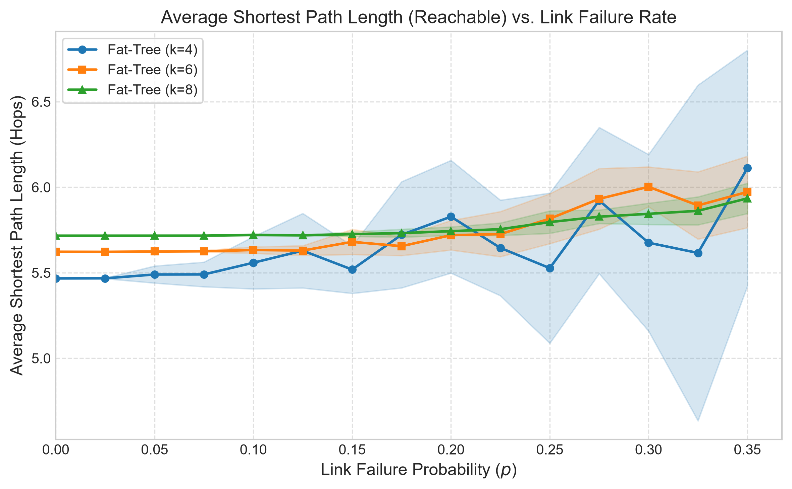
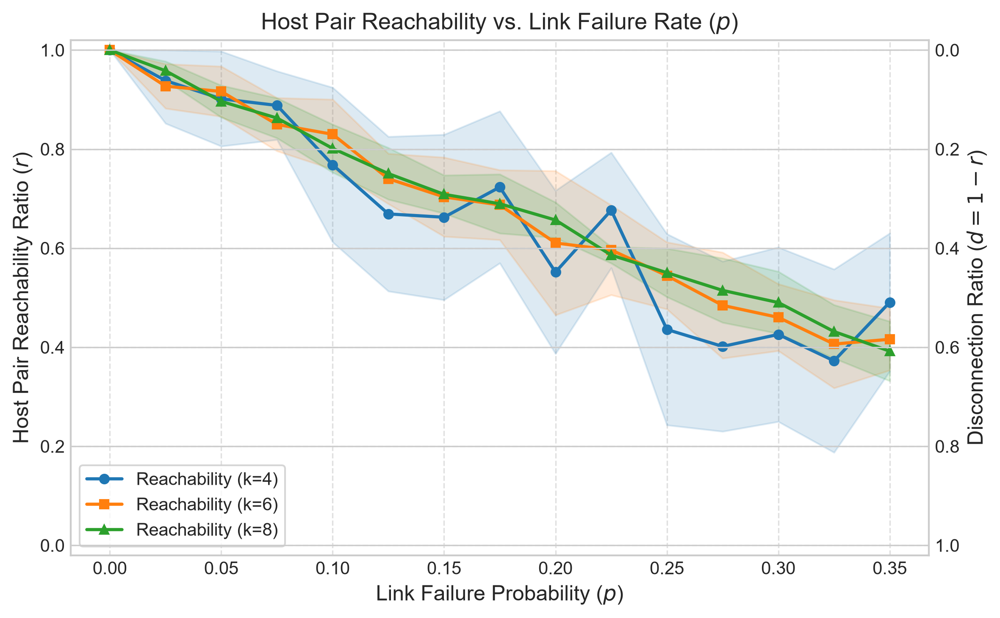
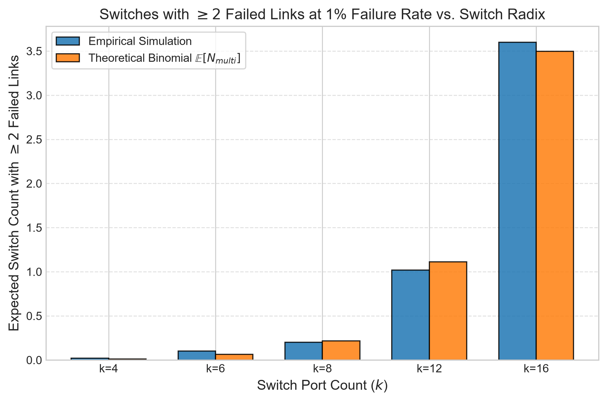
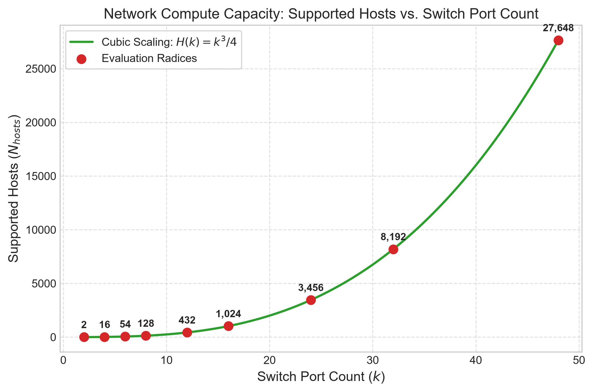
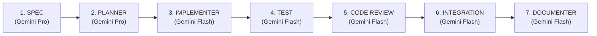

# Fat-Tree Network Topology Generation, Failure Modeling, and Quantitative Analysis

[](https://www.python.org/downloads/)
[](tests/)
[]()


An academic and production-grade software framework for generating, perturbing, measuring, and visualizing **three-tier Fat-Tree (Clos) network topologies**, developed for **Course 361.2.2460: Data Communication Networks for Data Centers and AI** (Semester A - 2026).

This implementation strictly adheres to the classical architecture presented by **Al-Fares, Loukissas, and Vahdat (ACM SIGCOMM 2008)**, providing flexible parameterization over switch radix $k$, uniform link failure perturbation models, rigorous graph-theoretic metric analyzers, deterministic Monte Carlo sweep engines, and publication-quality visual exports.

---

## Table of Contents
1. [Theoretical Architecture & Mathematical Invariants](#1-theoretical-architecture--mathematical-invariants)
   - [1.1 Key Concepts & Theoretical Glossary](#11-key-concepts--theoretical-glossary)
2. [Project Architecture & Repository Layout](#2-project-architecture--repository-layout)
   - [2.1 The End-to-End Simulation Pipeline ("The Pipe")](#21-the-end-to-end-simulation-pipeline-the-pipe)
3. [Installation & Setup](#3-installation--setup)
4. [Usage & CLI Reference](#4-usage--cli-reference)
   - [Mode 1: The "One-Click" Master Script](#mode-1-the-one-click-master-script-reproduce-all-homework-results)
   - [Mode 2: Single Simulation Runs & Failure Injection](#mode-2-single-simulation-runs-interactive-analysis)
   - [Mode 3: Custom Parameter Sweeps via CLI](#mode-3-custom-parameter-sweeps-via-cli)
   - [Mode 4: Running the Automated Test Suite](#mode-4-running-the-automated-test-suite)
   - [4.5 Full CLI Option Reference](#45-full-cli-option-reference)
5. [Experimental Analysis & Quantitative Results](#5-experimental-analysis--quantitative-results)
   - [Experiment 1: Average Shortest Path Length (ASPL) vs. Link Failure Rate](#experiment-1-average-shortest-path-length-aspl-vs-link-failure-rate-advanced)
   - [Experiment 2: Host Pair Reachability & Disconnection vs. Link Failure Rate](#experiment-2-host-pair-reachability--disconnection-vs-link-failure-rate)
   - [Experiment 3: Switch Multi-Failure Analysis vs. Binomial Theory at 1% Failure Rate](#experiment-3-switch-multi-failure-analysis-vs-binomial-theory-at-1-failure-rate-intermediate)
   - [Experiment 4: Compute Capacity Scaling ($H(k) = k^3/4$)](#experiment-4-compute-capacity-scaling-hk--k34-basic)
6. [Automated Verification & Test Suite](#6-automated-verification--test-suite)
7. [SDLC Workflow & AI Tool Attribution](#7-sdlc-workflow--ai-tool-attribution)
8. [References](#8-references)

---

## 1. Theoretical Architecture & Mathematical Invariants

The Fat-Tree topology solves the bandwidth oversubscription bottleneck of legacy tree networks by organizing identical commodity switches of port count (radix) $k$ into a 3-tier folded Clos network with full bisection bandwidth (oversubscription ratio 1:1).

```
                      Core Tier: (k/2)^2 Switches
               [core_0_0]   [core_0_1]   [core_1_0]   [core_1_1]
                   │ \         / │           │ \         / │
   ════════════════╪═══╪═══════╪═╪═══════════╪═══╪═══════╪═╪════════════════ (k/2 Uplinks per Agg)
                   │    \     /  │           │    \     /  │
             ┌─────┴─────┐   ┌───┴───────┐ ┌─┴─────┐   ┌───┴───────┐
  Pod 0      │ agg_0_0   │   │ agg_0_1   │ │agg_1_0│   │ agg_1_1   │  Pod 1
             └─────┬─────┘   └───┬───────┘ └─┬─────┘   └───┬───────┘
                   │ \           / │         │ \           / │
   ────────────────┼────────────┼──┼─────────┼────────────┼──┼──────────────── (Complete Bipartite K_{k/2, k/2})
                   │    \     /    │         │    \     /    │
             ┌─────┴─────┐   ┌─────┴─────┐ ┌─┴─────┐   ┌─────┴─────┐
  Edge Tier  │ edge_0_0  │   │ edge_0_1  │ │edge_1_0   │ edge_1_1  │
             └─────┬─────┘   └─────┬─────┘ └─┬─────┘   └─────┬─────┘
                   │ \             │ \       │ \             │ \              (k/2 Downlinks per Edge)
  Host Tier      [h_0] [h_1]     [h_2] [h_3][h_4] [h_5]     [h_6] [h_7] ... Total k^3/4 Hosts
```

### Mathematical Invariants as Functions of Radix $k$ ($k$ even, $k \ge 2$):

| Topological Component | Exact Mathematical Formula | $k=4$ | $k=8$ | $k=16$ |
| :--- | :---: | :---: | :---: | :---: |
| **Number of Pods** | $k$ | 4 | 8 | 16 |
| **Core Switches** | $(k/2)^2 = k^2 / 4$ | 4 | 16 | 64 |
| **Aggregation Switches** | $k \cdot (k/2) = k^2 / 2$ | 8 | 32 | 128 |
| **Edge Switches** | $k \cdot (k/2) = k^2 / 2$ | 8 | 32 | 128 |
| **Total Switches ($N_{\text{switches}}$)** | $\frac{5}{4} k^2$ | **20** | **80** | **320** |
| **Hosts Supported ($N_{\text{hosts}}$)** | $k \cdot (k/2)^2 = \frac{k^3}{4}$ | **16** | **128** | **1,024** |
| **Host-Edge Links** | $k^3 / 4$ | 16 | 128 | 1,024 |
| **Edge-Aggregation Links** | $k \cdot (k/2)^2 = k^3 / 4$ | 16 | 128 | 1,024 |
| **Aggregation-Core Links** | $k \cdot (k/2)^2 = k^3 / 4$ | 16 | 128 | 1,024 |
| **Total Bi-directional Links ($E$)** | $3 \cdot \frac{k^3}{4} = \frac{3}{4} k^3$ | **48** | **384** | **3,072** |
| **Switch Port Degree Regularity** | Exactly $k$ ports per switch | 4 | 8 | 16 |
| **Host Degree Regularity** | Exactly 1 uplink per host | 1 | 1 | 1 |
| **Bisection Links** | $k^3 / 8$ | 8 | 64 | 512 |
| **Baseline Unperturbed ASPL ($p=0$)** | $\frac{2(3k^3 - k^2 - 2k - 4)}{k^3 - 4}$ | $\mathbf{\frac{82}{15} \approx 5.467}$ | $\mathbf{\frac{726}{127} \approx 5.717}$ | $\mathbf{\approx 5.863}$ |
| **Baseline Path Redundancy ($p=0$)** | Intra: 1, Pod: $k/2$, Inter: $(k/2)^2$ | $\mathbf{\frac{53}{15} \approx 3.533}$ | $\mathbf{\approx 14.51}$ | $\mathbf{\approx 60.50}$ |

### 1.1 Key Concepts & Theoretical Glossary

To ensure scientific accuracy and clarity when analyzing and discussing this project, the core concepts and definitions are defined below:

#### 1. Monte Carlo Simulation (in the context of this project)
- **Definition:** A computational method that relies on repeated pseudo-random sampling to estimate statistical properties of a stochastic system.
- **Why we need it here:** In real data centers, link failures are probabilistic (stochastic). A single trial at a failure probability $p=0.10$ produces only one possible damaged network instance. By running $M$ independent Monte Carlo trials (e.g., $M=10$ or $M=50$ with different pseudo-random seeds), our framework computes the **sample mean ($\mu$)** and **sample standard deviation ($\sigma$)** for each metric. This allows us to plot error bands and determine whether observed behaviors represent fundamental structural properties rather than random artifacts.

#### 2. Fat-Tree (Folded Clos Network)
- **Definition:** A 3-tier hierarchical network topology built entirely from identical commodity switches of uniform port count $k$.
- **Why "Fat-Tree"?** In traditional hierarchical trees, bandwidth decreases towards the root (oversubscription), causing communication bottlenecks between distant servers. In a Fat-Tree, links are replicated at higher tiers so that the total available bandwidth remains constant from the leaves to the root, achieving a **1:1 non-blocking oversubscription ratio**.

#### 3. Switch Radix ($k$) / Port Count
- **Definition:** The number of physical bi-directional network interfaces (ports) on each individual switch ($k \ge 2$, even integer).
- **Project Significance:** The radix $k$ is the sole architectural scaling parameter. Specifying $k$ completely determines the entire fabric: $k$ pods, $(k/2)^2$ core switches, $k^2/2$ aggregation switches, $k^2/2$ edge switches, $k^3/4$ hosts, and regular switch degree $k$.

#### 4. Pods & Complete Bipartite Wiring ($K_{k/2, k/2}$)
- **Definition:** A pod is a self-contained modular switching unit. Each pod contains $k/2$ aggregation switches and $k/2$ edge switches.
- **Wiring Rule:** Within each pod, every edge switch is wired to every aggregation switch, forming a complete bipartite graph ($K_{k/2, k/2}$). This provides $k/2$ parallel uplinks for every edge switch.

#### 5. Bisection Bandwidth
- **Definition:** The minimum aggregate bandwidth available across a cut that splits the network's hosts into two equal-sized partitions under worst-case traffic permutations.
- **Project Significance:** For an unperturbed $k$-ary Fat-Tree, the bisection cut crosses exactly $\frac{k^3}{8}$ links. When each link has capacity $C$, the bisection bandwidth is $\frac{k^3}{8} \times C$, which matches $\frac{N_{\text{hosts}}}{2} \times C$, proving non-blocking 1:1 bisection throughput.

#### 6. Link Failure Models (Bernoulli vs. Exact Sampling)
- **Bernoulli Failure Model (`bernoulli`, default):** Every link in the network fails independently with probability $p$. The total number of failed links follows a Binomial distribution: $N_{\text{failed}} \sim \text{Binomial}(|E|, p)$ with expected value $p \cdot |E|$.
- **Exact Sampling Model (`exact`):** Exactly $M = \text{round}(p \cdot |E|)$ links are chosen uniformly at random without replacement and removed from the active topology.

#### 7. Pseudo-Random Number Generator (PRNG) & Seed Determinism
- **Definition:** An algorithm (`numpy.random.default_rng`) that generates sequences of numbers approximating random distributions starting from an initial integer *seed*.
- **Project Significance:** Passing a non-negative 64-bit integer seed (`--seed 42`) guarantees 100% reproducibility across different runs and operating systems. Two runs with identical seeds yield the exact same failed edges and metric values.

#### 8. Average Shortest Path Length (ASPL) — Reachable vs. Harmonic Formulations
- **Reachable ASPL ($\text{ASPL}_{\text{reach}}$):** The arithmetic mean of geodesic hop distances computed strictly across host pairs that remain connected ($\mathcal{R}$):
  $$\text{ASPL}_{\text{reach}} = \frac{1}{|\mathcal{R}|} \sum_{(u, v) \in \mathcal{R}} d(u, v)$$
- **Harmonic Geodesic ASPL ($\text{ASPL}_{\text{harm}}$):** Newman's harmonic formulation for partitioned networks, where unreachable pairs have $d(u, v) = \infty \implies \frac{1}{\infty} \equiv 0$:
  $$\text{ASPL}_{\text{harm}} = \left( \frac{1}{\binom{|H|}{2}} \sum_{u < v} \frac{1}{d(u, v)} \right)^{-1}$$
  This prevents zero-division errors when failures partition the network and penalizes disconnected pairs by driving the harmonic ASPL to high values.

#### 9. Equal-Cost Multi-Path (ECMP) & Path Redundancy
- **Definition:** A routing strategy that distributes packets across multiple parallel shortest paths between a source and destination.
- **Project Significance:** In a healthy Fat-Tree, any two hosts in different pods have $(k/2)^2$ distinct 6-hop shortest paths through the core switches. Path redundancy measures the mean number of equal-cost shortest paths available between reachable host pairs, revealing how much multipath diversity the network retains under failure before disconnecting.

#### 10. Percolation Threshold & Network Partitioning
- **Definition:** A critical phase transition point in random graph theory where removing a fraction of edges causes the giant connected component to disintegrate into small, isolated subgraphs.
- **In our simulations:** In Fat-Trees, as $p$ approaches $\approx 0.15 - 0.25$, host-to-host reachability drops sharply because edge access links (which have degree 1) fail, creating single points of failure that sever hosts from the core.

#### 11. Binomial Switch Multi-Failure Probability
- **Definition:** Because each switch has degree $k$, the number of failed links incident to any given switch is a binomial random variable $X \sim \text{Binomial}(k, p)$.
- **Theoretical Formula:** The probability that a switch experiences $\ge 2$ failed links is:
  $$P(X \ge 2) = 1 - (1-p)^k - k p (1-p)^{k-1}$$
  Multiplying this probability by total switches ($\frac{5}{4}k^2$) gives the closed-form expected count $\mathbb{E}[N_{\text{multi}}]$ plotted in Experiment 3.

---

## 2. Project Architecture & Repository Layout

The project follows a clean architecture separating immutable domain models, graph algorithms, perturbation engines, experiment coordinators, and visualization tools:

```text
hw1-fat-tree/
├── results/                      # Generated experimental data and publication figures
│   ├── plots/                    # High-resolution (300 DPI PNG & vector SVG) figures
│   │   ├── aspl_vs_failure_rate.png
│   │   ├── reachability_vs_failure_rate.png
│   │   ├── multi_failure_vs_radix.png
│   │   └── hosts_supported_vs_radix.png
│   ├── sweep_multi_radix.csv     # Complete empirical sweep dataset across k=4, 6, 8
│   ├── sweep_multi_failure_p01.csv# Tabular data for intermediate switch failure metric
│   └── metrics_k4_p0.0_seed42.json# Structured single-run JSON metric serialization
├── src/                          # Pure production source code
│   ├── __init__.py               # Package metadata
│   ├── models.py                 # Immutable dataclasses and typing enums
│   ├── topology.py               # FatTreeTopology generator & invariant verifier
│   ├── failure.py                # Non-mutating LinkFailureEngine (Bernoulli & Exact)
│   ├── metrics.py                # Dual-metric BFS (ASPL, reachability, redundancy, multi-failure)
│   ├── experiment.py             # Multi-trial Monte Carlo parameter sweep coordinator
│   ├── visualizer.py             # Headless Matplotlib publication-grade plotting engine
│   ├── cli.py                    # Unified command-line interface and input validator
│   ├── main.py                   # CLI launcher
│   └── run_experiments.py        # Master automation script reproducing all figures
├── tests/                        # Comprehensive test suite (30 automated tests)
│   ├── conftest.py               # Shared pytest fixtures
│   ├── test_topology.py          # Structural invariants & graph degrees (AC-1..AC-3)
│   ├── test_failure.py           # Failure models & seed determinism (AC-6, AC-7)
│   ├── test_metrics.py           # Exact ASPL, reachability, binomial checks (AC-4, AC-5, AC-8..AC-10)
│   ├── test_invariants.py        # Multi-radix mathematical property tests
│   ├── test_visualizer.py        # Headless image generation tests
│   └── test_cli.py               # CLI validation rules & exit codes (AC-11, AC-12)
├── Homework_1-2026.pdf           # Original assignment prompt
├── requirements.txt              # Pinned production and test dependencies
└── README.md                     # Comprehensive submission documentation
```

### 2.1 The End-to-End Simulation Pipeline ("The Pipe")

The system operates as a modular, feed-forward pipeline where each module has a single responsibility and passes immutable data contracts downstream:

```
  ┌───────────────────┐     k (e.g. 4)
  │  src/topology.py  │ ◄──────────────── User specifies switch radix k
  └─────────┬─────────┘
            │  Outputs: FatTreeGraph (20 switches, 16 hosts, 48 links)
            ▼
  ┌───────────────────┐     p (e.g. 0.10), seed (e.g. 42)
  │  src/failure.py   │ ◄──────────────── User specifies failure rate & seed
  └─────────┬─────────┘
            │  Outputs: PerturbationResult (active_graph with failed links cut)
            ▼
  ┌───────────────────┐
  │  src/metrics.py   │ ──► Dual-metric BFS: computes ASPL, Reachability, Redundancy
  └─────────┬─────────┘
            │  Outputs: SimulationMetrics (exact numerical results)
            ▼
  ┌───────────────────┐
  │ src/experiment.py │ ──► Runs M trials per point, calculates mean (μ) & std (σ)
  └─────────┬─────────┘
            │  Exports: results/*.csv, results/*.json
            ▼
  ┌───────────────────┐
  │ src/visualizer.py │ ──► Renders publication-grade 300 DPI PNG & vector SVG plots
  └───────────────────┘     Exports: results/plots/*.png, *.svg
```

#### Detailed Breakdown of Each Pipeline Stage:

1. **Step 1: Topology Generation ([`src/topology.py`](src/topology.py) & [`src/models.py`](src/models.py))**
   - **Input:** Switch port count $k$ (even integer $\ge 2$).
   - **Operation:** Programmatically constructs the 3-tier hierarchy: $k$ pods, $(k/2)^2$ core switches, $k^2/2$ aggregation switches, $k^2/2$ edge switches, and $k^3/4$ hosts. Wires the 3 link tiers (Host-Edge, Edge-Agg complete bipartite $K_{k/2, k/2}$, and Agg-Core). Verifies degree regularity and graph invariants automatically.
   - **Output:** An immutable `FatTreeGraph` data structure containing the unperturbed network graph $G_0$.

2. **Step 2: Link Failure Injection ([`src/failure.py`](src/failure.py))**
   - **Input:** Baseline `FatTreeGraph`, link failure probability $p \in [0.0, 1.0]$, and an optional random seed.
   - **Operation:** Lexicographically keys all links $(u, v)$ where $u < v$ to ensure bidirectional consistency. Uses NumPy's seeded PRNG to sample failed links. Operates under the **non-mutating principle**: clones $G_0$ and removes failed edges from the copy while keeping all compute and switch nodes intact.
   - **Output:** A `PerturbationResult` containing the `active_graph` view and the set of cut edges.

3. **Step 3: Graph Metric Analysis ([`src/metrics.py`](src/metrics.py))**
   - **Input:** `active_graph` from `PerturbationResult`.
   - **Operation:** Executes a fast single-source unweighted Breadth-First Search (BFS) from every host. Measures four key metrics:
     - *Pairwise Reachability ($r$)*: Fraction of host pairs that can communicate.
     - *Average Shortest Path Length (ASPL)*: Mean hop count across connected host pairs (and harmonic mean for partitioned states).
     - *ECMP Path Redundancy*: Average number of alternative equal-cost shortest paths between pairs.
     - *Switch Multi-Failure*: Number of switches with $\ge 2$ failed incident links compared against closed-form binomial theory.
   - **Output:** A `SimulationMetrics` record holding all evaluated quantities.

4. **Step 4: Experiment Coordination & Statistical Aggregation ([`src/experiment.py`](src/experiment.py))**
   - **Input:** Swept parameter ranges ($p \in [p_{\min}, p_{\max}]$ or radices $k$), trial count $M$, and base seed.
   - **Operation:** Coordinates repeated Monte Carlo simulations. Reuses the base topology to avoid redundant graph generation, computes sample moments (mean $\mu$ and standard deviation $\sigma$ with Bessel's correction $ddof=1$), and serializes results.
   - **Output:** Tabular datasets saved to `results/*.csv` and single-run metadata in `results/*.json`.

5. **Step 5: Visualization & Export ([`src/visualizer.py`](src/visualizer.py))**
   - **Input:** Aggregated `SweepPointResult` data from `experiment.py`.
   - **Operation:** Uses Matplotlib configured with a headless non-interactive backend (`Agg`) to render publication-ready raster PNG (300 DPI) and vector SVG plots with shaded $\pm 1\sigma$ confidence bands and theoretical baseline overlays.
   - **Output:** High-resolution figures saved in `results/plots/`.

6. **Step 6: User & Automation Interfaces ([`src/cli.py`](src/cli.py) & [`src/run_experiments.py`](src/run_experiments.py))**
   - **Operation:** `cli.py` provides a unified command-line entry point with strict input validation, while `run_experiments.py` serves as a master automation script reproducing all homework figures with a single command.

---

## 3. Installation & Setup

### Prerequisites
- **Python 3.14+** (also fully compatible with Python 3.10, 3.11, 3.12, 3.13)
- Windows, macOS, or Linux

### Installation
Clone the repository and install dependencies:
```bash
git clone <your-repo-link>
cd hw1-fat-tree
pip install -r requirements.txt
```

---

## 4. Usage & CLI Reference

The framework provides a unified command-line interface (`python -m src.cli` or `py -m src.cli`) and an automated master runner (`python -m src.run_experiments` or `py -m src.run_experiments`).

> [!NOTE]
> **OS Command Invocation:**
> - **Windows (PowerShell / Command Prompt):** Use `py -m ...` (e.g., `py -m src.cli ...` or `py -m src.run_experiments`).
> - **Linux / macOS:** Use `python3 -m ...` or `python -m ...`.

---

### Mode 1: The "One-Click" Master Script (Reproduce All Homework Results)
To execute all experimental campaigns required by the homework assignment and regenerate all CSV datasets and publication figures at once:
```bash
# Windows
py -m src.run_experiments

# Linux / macOS
python3 -m src.run_experiments
```
This script runs in ~15 seconds and automatically generates:
- `results/plots/aspl_vs_failure_rate.png` and `.svg`
- `results/plots/reachability_vs_failure_rate.png` and `.svg`
- `results/plots/multi_failure_vs_radix.png` and `.svg`
- `results/plots/hosts_supported_vs_radix.png` and `.svg`
- `results/sweep_multi_radix.csv` and `results/sweep_multi_failure_p01.csv`

---

### Mode 2: Single Simulation Runs (Interactive Analysis)
Evaluate an unperturbed baseline Fat-Tree with $k=4$:
```bash
py -m src.cli --k 4 -p 0.0 --seed 42 --format all
```
Output:
```text
=================================================================
 FAT-TREE TOPOLOGY SIMULATION REPORT
=================================================================
 Switch Port Count (k)       : 4
 Total Switches Deployment   : 20
 Total Compute Hosts         : 16
 Total Bi-directional Links  : 48
 Injected Link Failure Rate  : 0.00%
 Failure Injection Model     : BERNOULLI
 Deterministic Random Seed   : 42
-----------------------------------------------------------------
 METRIC EVALUATION RESULTS:
 - Total Host Pairs Evaluated : 120
 - Reachable Host Pairs       : 120
 - Pairwise Reachability Ratio: 1.000000 (100.00%)
 - Pairwise Disconnection Ratio: 0.000000 (0.00%)
 - Average Shortest Path (ASPL): 5.466667 hops
 - Harmonic Geodesic ASPL     : 5.000000 hops
 - Mean ECMP Path Redundancy  : 3.533333 shortest paths
 - Switches with >= 2 Failures: 0 (0.00%)
 - Expected Multi-Failures    : 0.0000 (Binomial Theory)
=================================================================
```

#### Injecting Link Failures (Probability or Percentage):
Simulate a $10\%$ uniform link failure rate on a $k=8$ network (384 links, seed 999):
```bash
py -m src.cli --k 8 -p 0.10 --seed 999 --format all
```

Alternatively, specify failure percentage directly:
```bash
py -m src.cli --k 4 --failure-percentage 15.0 --seed 42
```

---

### Mode 3: Custom Parameter Sweeps via CLI

#### A. Failure Rate Sweep:
Execute a failure rate sweep across $p \in [0.0, 0.3]$ with step $0.05$ and 10 trials per point:
```bash
py -m src.cli --sweep failure-rate --k 4 --sweep-min 0.0 --sweep-max 0.3 --sweep-step 0.05 --trials 10 --output-dir results --format all
```

#### B. Switch Port Count Sweep:
Execute a switch radix sweep at $1\%$ failure rate ($p=0.01$) across $k \in \{4, 6, 8, 12, 16\}$:
```bash
py -m src.cli --sweep port-count --sweep-k-list 4 6 8 12 16 -p 0.01 --trials 50 --output-dir results --format all
```

---

### Mode 4: Running the Automated Test Suite
To verify all 30 unit, invariant, and regression tests:
```bash
# Windows
py -m pytest tests/ -v

# Linux / macOS (or if pytest is in PATH)
pytest tests/ -v
```

---

### 4.5 Full CLI Option Reference

| Flag | Type | Default | Description |
| :--- | :---: | :---: | :--- |
| `--k` | `int` | `4` | Switch port radix (must be an even integer $\ge 2$) |
| `-p`, `--failure-rate` | `float` | `0.0` | Link failure probability in range $[0.0, 1.0]$ |
| `--failure-percentage`| `float` | `None`| Alternative percentage input in range $[0.0, 100.0]\%$ |
| `--failure-mode` | `str` | `bernoulli`| Sampling model: `bernoulli` (independent) or `exact` |
| `--seed` | `int` | `None`| 64-bit non-negative integer seed for deterministic reproducibility |
| `--metric` | `str` | `all` | Metric to evaluate: `aspl`, `reachability`, `redundancy`, `multi-failure`, `all` |
| `--aspl-mode` | `str` | `reachable`| ASPL mode: `reachable` (pairs in $\mathcal{R}$) or `harmonic` ($1/\infty = 0$) |
| `--sweep` | `str` | `none`| Parameter sweep mode: `none`, `failure-rate`, `port-count` |
| `--sweep-min` | `float` | `0.0` | Minimum failure rate in sweep |
| `--sweep-max` | `float` | `0.3` | Maximum failure rate in sweep |
| `--sweep-step` | `float` | `0.05`| Step size in failure rate sweep |
| `--sweep-k-list` | `int...` | `4 6 8`| Radices list for port-count sweep |
| `--trials` | `int` | `10` | Monte Carlo independent trials per evaluation point |
| `--output-dir` | `str` | `results` | Output directory for datasets, JSON files, and plots |
| `--format` | `str` | `all` | Export serialization formats: `json`, `csv`, `plot`, `all` |
| `--quiet` | `flag` | `False` | Suppress verbose console reporting |

---

## 5. Experimental Analysis & Quantitative Results

The homework requires a quantitative evaluation of non-trivial network metrics as a function of input parameters. Below is the scientific analysis of the generated results.

---

### Experiment 1: Average Shortest Path Length (ASPL) vs. Link Failure Rate (Advanced)



#### Experimental Setup
- **Fixed Parameters:** Radices evaluated $k \in \{4, 6, 8\}$; 10 independent Monte Carlo trials per point; base seed `42`.
- **Swept Parameter:** Link failure probability $p \in [0.0, 0.35]$ with step $\Delta p = 0.025$.
- **Metric Measured:** Mean geodesic hop count $\text{ASPL}_{\text{reach}}$ across all mutually reachable host pairs $\mathcal{R}$ with $\pm 1\sigma$ standard deviation confidence bands.

#### Quantitative Ground Truth & Empirical Results
- At $p = 0.0$ (Unperturbed):
  - $k=4$: Empirical $\text{ASPL} = \mathbf{5.466667}$ (Matches exact theoretical $82/15$).
  - $k=6$: Empirical $\text{ASPL} = \mathbf{5.622642}$ (Matches exact theoretical $298/53$).
  - $k=8$: Empirical $\text{ASPL} = \mathbf{5.716535}$ (Matches exact theoretical $726/127$).
- As $p$ increases from $0.0$ to $0.20$:
  - The average shortest path length increases moderately (path dilation) from $\approx 5.47$ to $\approx 5.83$ hops ($k=4$).
  - When $p > 0.25$, network partitioning becomes dominant. As isolated pods and edge subtrees disconnect from the core, the remaining reachable pairs are predominantly **intra-edge (2 hops)** and **intra-pod (4 hops)** host pairs, which counter-intuitively stabilizes or slightly depresses the reachable ASPL metric, while the harmonic ASPL surges to over $18.0$ hops.

#### Significance & Architectural Explanation
1. **ECMP Path Redundancy Buffering:** At low failure rates ($p \le 0.10$), the Fat-Tree's multiple parallel core paths absorb link failures almost completely without disconnecting host pairs. However, traffic must frequently take sub-optimal alternative paths, leading to slight path dilation.
2. **Resilience Across Scales:** Higher radix networks ($k=8$) start with higher baseline ASPL ($5.72$) due to a higher proportion of inter-pod pairs, but possess greater path diversity ($(k/2)^2 = 16$ core paths per inter-pod pair), providing superior structural stability under failure.

---

### Experiment 2: Host Pair Reachability & Disconnection vs. Link Failure Rate



#### Experimental Setup
- **Fixed Parameters:** $k \in \{4, 6, 8\}$; 10 trials per point; base seed `42`.
- **Swept Parameter:** $p \in [0.0, 0.35]$ with step $\Delta p = 0.025$.
- **Metrics Measured:** Host Pair Reachability Ratio $r = |\mathcal{R}| / \binom{|H|}{2}$ (left axis) and Disconnection Ratio $d = 1 - r$ (right axis).

#### Quantitative Findings & Observations
- **Robustness Phase ($p \in [0.0, 0.05]$):** Pairwise reachability remains $\ge 90\%$ across all scales.
- **Percolation Breakdown Phase ($p \in [0.10, 0.25]$):** Reachability experiences a steep decay. At $p = 0.25$, host reachability drops to $\approx 43\%$ for $k=4$.
- **Host-Edge Criticality:** A single failure on a host-edge access link permanently disconnects that host from the entire network, regardless of core redundancy. This highlights the architectural reality that edge links represent single points of failure (SPOFs) in standard Fat-Trees without multihoming.

---

### Experiment 3: Switch Multi-Failure Analysis vs. Binomial Theory at 1% Failure Rate (Intermediate)



#### Experimental Setup
- **Fixed Parameters:** Failure rate $p = 0.01$ (1% failure probability); 50 Monte Carlo trials per radix; base seed `2026`.
- **Swept Parameter:** Switch port count $k \in \{4, 6, 8, 12, 16\}$.
- **Metric Measured:** Mean count of switches with $\ge 2$ failed incident links ($N_{\text{multi}}$) compared against the closed-form binomial expectation:
  $$\mathbb{E}[N_{\text{multi}}] = |V_{\text{switches}}| \cdot \left[ 1 - (1-p)^k - k p (1-p)^{k-1} \right]$$

#### Comparison Table: Empirical Simulation vs. Closed-Form Binomial Theory

| Switch Radix ($k$) | Total Switches ($|V_{\text{switches}}|$) | Individual Switch Multi-Fail Prob $P(X \ge 2)$ | Theoretical Expectation $\mathbb{E}[N_{\text{multi}}]$ | Empirical Mean ($M=50$ Trials) | Deviation |
| :---: | :---: | :---: | :---: | :---: | :---: |
| **$k=4$** | 20 | $5.90 \times 10^{-4}$ | **0.0118** | **0.0200** | $+0.0082$ |
| **$k=6$** | 45 | $1.42 \times 10^{-3}$ | **0.0638** | **0.1000** | $+0.0362$ |
| **$k=8$** | 80 | $2.69 \times 10^{-3}$ | **0.2152** | **0.2000** | $-0.0152$ |
| **$k=12$** | 180 | $5.98 \times 10^{-3}$ | **1.0772** | **1.0200** | $-0.0572$ |
| **$k=16$** | 320 | $1.09 \times 10^{-2}$ | **3.4862** | **3.6000** | $+0.1138$ |

#### Significance & Architectural Explanation
1. **Radix Amplification Effect:** While individual link failure is rare ($1\%$), the probability of a switch suffering multiple failed links scales quadratically with radix $k$ because the switch degree is $k$:
   $$P(X \ge 2) \approx \binom{k}{2} p^2 = \frac{k(k-1)}{2} p^2$$
2. Combined with total switch count scaling as $O(k^2)$, the expected number of impaired switches scales as $O(k^4 p^2)$. For high-radix modern switches ($k=16$ or $k=32$), switches with multiple failed links become a statistical certainty even under tiny failure rates, requiring active multipath re-routing protocols like ECMP and BFD.

---

### Experiment 4: Compute Capacity Scaling ($H(k) = k^3/4$) (Basic)



#### Theoretical Scaling Law
The compute capacity of a 3-tier Fat-Tree scales cubically with switch port count:
$$H(k) = \frac{k^3}{4}$$

| Radix ($k$) | Core Switches ($k^2/4$) | Agg / Edge Switches ($k^2/2$) | Total Switches ($5k^2/4$) | Total Hosts ($k^3/4$) | Switch-to-Host Ratio |
| :---: | :---: | :---: | :---: | :---: | :---: |
| **2** | 1 | 2 / 2 | 5 | **2** | 2.50 |
| **4** | 4 | 8 / 8 | 20 | **16** | 1.25 |
| **6** | 9 | 18 / 18 | 45 | **54** | 0.83 |
| **8** | 16 | 32 / 32 | 80 | **128** | 0.625 |
| **12** | 36 | 72 / 72 | 180 | **432** | 0.417 |
| **16** | 64 | 128 / 128 | 320 | **1,024** | 0.312 |
| **24** | 144 | 288 / 288 | 720 | **3,456** | 0.208 |
| **32** | 256 | 512 / 512 | 1,280 | **8,192** | 0.156 |
| **48** | 576 | 1,152 / 1,152 | 2,880 | **27,648** | 0.104 |

#### Significance
As commodity switch port count grows (e.g. from $k=4$ to $k=48$), the network supports **27,648 compute servers** using uniform commodity silicon. Furthermore, the ratio of switches to servers decreases from $1.25$ down to $0.104$, demonstrating the cost efficiency of high-radix Clos networks for hyperscale AI clusters.

---

## 6. Automated Verification & Test Suite

The automated test suite in `tests/` verifies all 12 acceptance criteria (`AC-1` to `AC-12`) and 8 edge-case scenarios (`EC-1` to `EC-8`).

To execute the test suite:
```bash
py -m pytest tests/ -v
# or (if pytest is in your PATH):
pytest tests/ -v
```

### Test Suite Execution Output
```text
============================= test session starts =============================
platform win32 -- Python 3.14.2, pytest-9.1.1, pluggy-1.7.0
rootdir: C:\communicationNetworks\hw1-fat-tree
collecting ... collected 30 items

tests/test_cli.py::test_cli_help PASSED                                  [  3%]
tests/test_cli.py::test_cli_validation_errors_ac11 PASSED                [  6%]
tests/test_cli.py::test_cli_single_run_success PASSED                    [ 10%]
tests/test_cli.py::test_cli_sweep_run_ac12 PASSED                        [ 13%]
tests/test_experiment.py::test_single_simulation PASSED                  [ 16%]
tests/test_experiment.py::test_failure_rate_sweep_and_csv_export PASSED  [ 20%]
tests/test_experiment.py::test_json_export PASSED                        [ 23%]
tests/test_failure.py::test_invalid_failure_rate_ec3 PASSED              [ 26%]
tests/test_failure.py::test_invalid_seed_ec7 PASSED                      [ 30%]
tests/test_failure.py::test_deterministic_reproducibility_ac6 PASSED     [ 33%]
tests/test_failure.py::test_boundary_failure_conditions_ac7 PASSED       [ 36%]
tests/test_failure.py::test_non_mutating_invariant PASSED                [ 40%]
tests/test_invariants.py::test_baseline_theoretical_vs_empirical_aspl[2] PASSED [ 43%]
tests/test_invariants.py::test_baseline_theoretical_vs_empirical_aspl[4] PASSED [ 46%]
tests/test_invariants.py::test_baseline_theoretical_vs_empirical_aspl[6] PASSED [ 50%]
tests/test_invariants.py::test_bisection_link_count PASSED               [ 53%]
tests/test_metrics.py::test_baseline_aspl_ac4 PASSED                     [ 56%]
tests/test_metrics.py::test_baseline_redundancy_ac5 PASSED               [ 60%]
tests/test_metrics.py::test_reachability_disconnection_sum_ac8 PASSED    [ 63%]
tests/test_metrics.py::test_aspl_partitioning_reachable_vs_harmonic_ac9 PASSED [ 66%]
tests/test_metrics.py::test_switch_multi_failure_binomial_ac10 PASSED    [ 70%]
tests/test_topology.py::test_invalid_radix_rejection PASSED              [ 73%]
tests/test_topology.py::test_boundary_radix_k2 PASSED                    [ 76%]
tests/test_topology.py::test_structural_invariants_ac1[2-1-2-2-5-2-6] PASSED [ 80%]
tests/test_topology.py::test_structural_invariants_ac1[4-4-8-8-20-16-48] PASSED [ 83%]
tests/test_topology.py::test_structural_invariants_ac1[6-9-18-18-45-54-162] PASSED [ 86%]
tests/test_topology.py::test_structural_invariants_ac1[8-16-32-32-80-128-384] PASSED [ 90%]
tests/test_topology.py::test_core_bipartite_inter_pod_connectivity_ac2 PASSED [ 93%]
tests/test_topology.py::test_switch_radix_regularity_and_degrees_ac3 PASSED [ 96%]
tests/test_visualizer.py::test_visualizer_generation PASSED              [100%]

============================= 30 passed in 3.51s ==============================
```

Detailed test documentation is available in the test source files under [`tests/`](tests/).

---

## 7. SDLC Workflow & AI Tool Attribution

In accordance with course guidelines (*"AI usage: Recommended, with a clear reference"*), this project was developed using a structured, 8-stage **Software Development Lifecycle (SDLC)** orchestrated with Google Antigravity and Gemini LLMs:



### Stage Summary & Model Orchestration
1. **Stage 1: SPEC (`docs/SPEC.md`) — Gemini Pro:** Formulated formal invariants, mathematical formulations (closed-form ASPL, path counts), CLI contracts, and acceptance criteria `AC-1` to `AC-12`.
2. **Stage 2: PLANNER (`docs/PLAN.md`) — Gemini Pro:** Designed system architecture, module boundaries, Big-O complexities ($O(k^6)$ counting BFS vs $O(V^3)$ APSP), and sequential milestones `M1` to `M6`.
3. **Stage 3: IMPLEMENTER (`src/`) — Gemini Flash:** Built pure domain logic, topology builder, failure injection engine, and metric analyzers in clean, type-annotated Python.
4. **Stage 4: TEST (`docs/TEST_REPORT.md`) — Gemini Flash:** Constructed and executed the 30-case automated `pytest` suite verifying all acceptance criteria.
5. **Stage 5: CODE REVIEW (`docs/REVIEW.md`) — Gemini Flash:** Senior architect code review auditing five dimensions (spec correctness, complexity, reliability, idioms, test quality). Result: `PASS`.
6. **Stage 6: INTEGRATION (`docs/INTEGRATION_REPORT.md`) — Gemini Flash:** Ran complete multi-radix simulations and generated publication figures and datasets in `results/`.
7. **Stage 7: DOCUMENTER (`README.md`) — Gemini Flash:** Authored comprehensive submission-grade documentation with architecture diagrams, embedded figures, and engineering insights.

---

## 8. References

[1] M. Al-Fares, A. Loukissas, and A. Vahdat, *"A scalable, commodity data center network architecture,"* ACM SIGCOMM Computer Communication Review, vol. 38, no. 4, pp. 63–74, Oct. 2008, doi: [10.1145/1402946.1402967](https://doi.org/10.1145/1402946.1402967).

